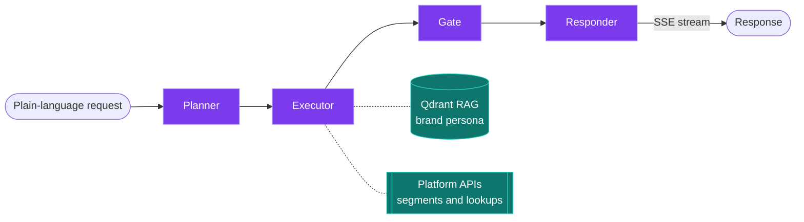

  
  
  

  
  
  
  

---

### 👋 About me

I'm an **AI Engineer who owns production AI products end to end**: architecture, backend, deployment, and client delivery. I ship **LangGraph multi-agent systems**, **RAG pipelines**, **MCP tool integrations**, and **LLM security guardrails** on **FastAPI**, used live by non-profit and business clients.

My work is backed by applied research in low-resource NLP and computer vision, with technical reports published on Zenodo.

| 🏢 Now | 🎓 Education | 📄 Research | 🎯 Focus |
|---|---|---|---|
| AI Engineer at **BigGorillaApps** (since Feb 2026) | BSc Computer Science, **Habib University** (2020 – 2025) | **3 technical reports** on Zenodo | Agentic AI · RAG · LLM security |

---

### 🚀 What I ship

Core engineer on a small team shipping **five live AI products** for non-profit and business clients at BigGorillaApps. Tap a product to expand.

<b>🧠 Skraggle Assist</b> — AI assistant for a non-profit fundraising and CRM platform

 

- LangGraph agent (**Planner → Executor → Gate → Responder**, FastAPI + SSE) that turns plain-language requests into branded landing pages, designed emails, and donor segments
- Playwright crawler that learns each charity's **brand persona** from its website (Cloudflare bypass fallbacks, sitemap discovery, resumable crawls) and feeds a **Qdrant RAG** layer whose answers cite source URLs
- **Natural-language segment builder**: "lapsed donors in London" becomes a segment-filter API payload, with IDs resolved through lookup APIs
- **12-layer guardrail system** (prompt injection, jailbreak, tool authorization and argument validation, data-leakage prevention, malicious URLs, scope control), verified by **50+ automated tests**
- Led a **13-category production-readiness audit**: found and fixed a cross-tenant data-access flaw, added per-token rate limiting (20/min, 300/day) and per-call cost logging

<b>🤝 crewGorilla</b> — multi-agent AI workspace for businesses

 

- Consolidated standalone agents (**Linda, Penny, Sonny, EVA**) into one **supervisor-agent monorepo** with rule-based routing, @mention targeting, and a shared Supabase context store
- Built **10 MCP server integrations** (Gmail, Google Calendar, Drive, Outlook Mail and Calendar, OneDrive, Jira, Zoom, HubSpot, Notion) through Nango-managed OAuth
- Secured all five chat endpoints with **Redis-backed per-user rate limiting** and two-tier input guardrails (regex pre-filter + LLM classifier) that also scan uploaded documents for injected prompts
- Document-to-knowledge-base ingestion for per-user clone agents, so agents answer from uploaded PDFs and DOCX files (reusing the Qdrant RAG pipeline)

<b>🤖 Agent products and analytics</b> — Sonny, Penny, Giverr, Skraggle analytics

 

- **Sonny** (AI social media manager): LangGraph multi-agent system with Facebook publishing, Flux image generation, multi-platform OAuth via Nango, and Langfuse prompt caching that cut per-turn overhead
- **Penny** (AI blog writer): five-node LangGraph pipeline on NVIDIA NIM covering brand onboarding, keyword and SERP research, outline, article, and SEO checks, with auto-publishing tested across 8 scenarios · [🎥 watch the demo](https://aqib420.github.io/landing-page/#demo)
- **Giverr Donor Agent**: autonomous **Plan → Verify → Execute → Review (PVER)** workflow with real-time API integrations for decision-making on a live bidding platform, plus a draft-first, five-stage campaign creation agent
- **Skraggle analytics**: turned research code into a production **XGBoost + Prophet** forecasting service projected to drive **$650k+** in campaign revenue; built donor churn (30/60/90-day), RFM, and smart-ask scoring

#### How a Skraggle Assist request flows

---

### 📄 Published research

Three technical reports from Habib University, each published on Zenodo with the code open on GitHub.

| Report | Key result | Links |
|---|---|---|
| **Sentiment Analysis of Roman Urdu Using LSTM, BERT, and GPT-2** Four-class classifier (incl. an *Abusive* class) for code-mixed text, built on a sentiment corpus merged with the RUHSOLD hate-speech dataset | Fine-tuned **GPT-2** wins: **70.24% accuracy**, **0.65 macro-F1**, beating mBERT despite English-only pre-training |  [Code ↗](https://github.com/aqib420/RomanUrduSentimentAnalysis) |
| **Identification of South Asian Musical Instruments Using CNNs** New dataset of ~6,000 four-second clips across 15 classes (sitar, bansuri, harmonium, tabla, and combinations) | Multi-label CNN on mel-spectrograms: **0.94 precision / recall / F1** vs **45%** for a KNN baseline |  [Code ↗](https://github.com/aqib420/South-Asian-Identification-Tensorflow) |
| **Deep Fake Detection Using Transfer Learning with the ReActNet-MobileNet Architecture** Leakage-free, video-level pipeline for Celeb-DF (v2) | Fine-tuned an ImageNet-pre-trained binary neural network (ReActNet) on class-balanced samples from **106k+ frames** |  [Code ↗](https://github.com/aqib420/CV-Project-me-) |

---

### 💼 Experience

| When | Role | Where |
|---|---|---|
| **Feb 2026 – Present** | AI Engineer | **BigGorillaApps** · London, UK (Remote) |
| Sep 2025 – Jan 2026 | Freelance NLP Developer | Independent · Remote. Confidential legal-sector NLP: fine-tuned Hugging Face classifiers, OpenAI API + spaCy |
| Jun 2025 – Aug 2025 | Machine Learning & AI Intern | **Bewhoop** · Remote. Real-time semantic search engine (FAISS + Sentence Transformers) over Supabase data |
| Jul 2024 – Sep 2024 | Software Engineering Fellow | **Headstarter** · Remote. Full-stack AI applications in an Agile/Scrum environment |

---

### ⚙️ Tech stack

**Agentic AI & LLMs**

**LLM security**

**Machine learning**

**Backend and cloud**

**Data and retrieval**

---

### 📌 Open-source projects

  
  
  
  

  Most of my production work lives in private client repositories, so the public graph understates it. See all public repos on <a href="https://github.com/aqib420?tab=repositories">GitHub</a>.

---

### 📫 Let's connect

I'm open to **AI engineering roles** and **freelance projects** involving agentic systems, RAG, and production ML.

  

